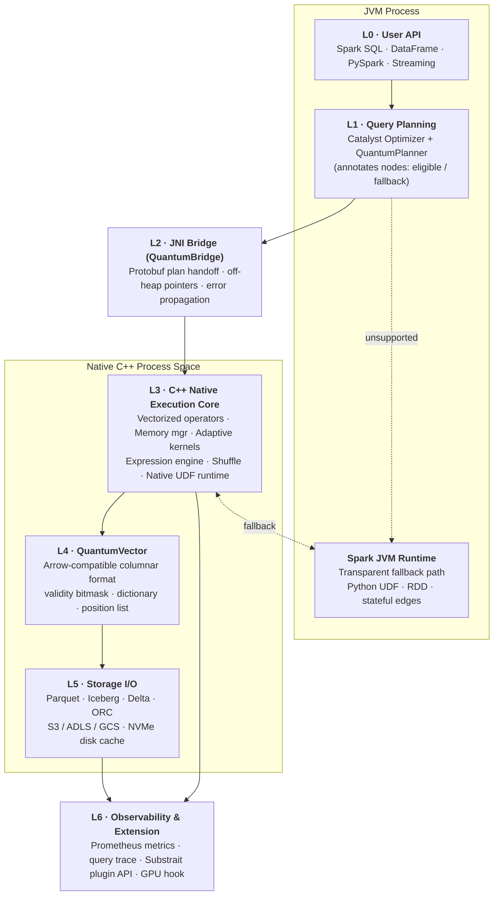
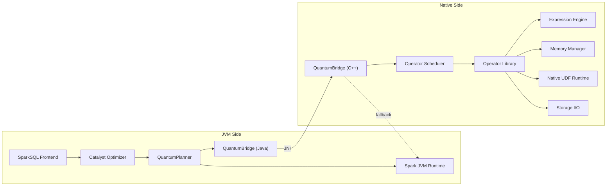
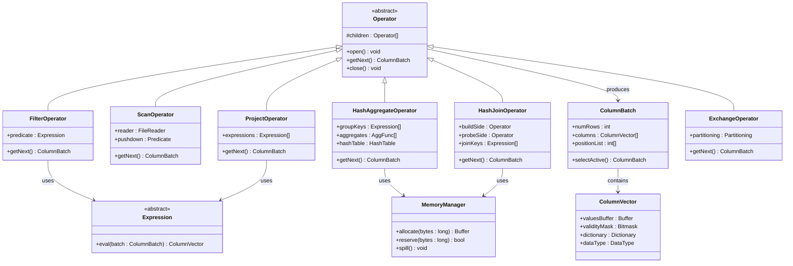
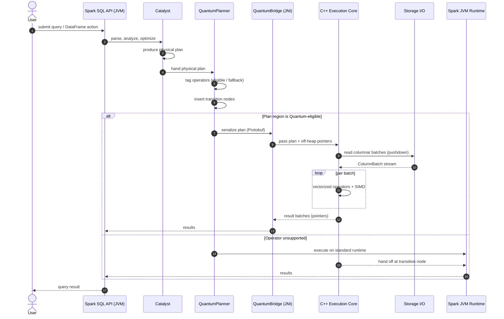
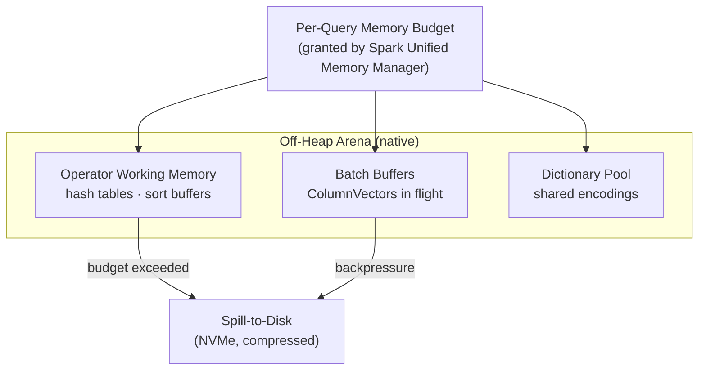
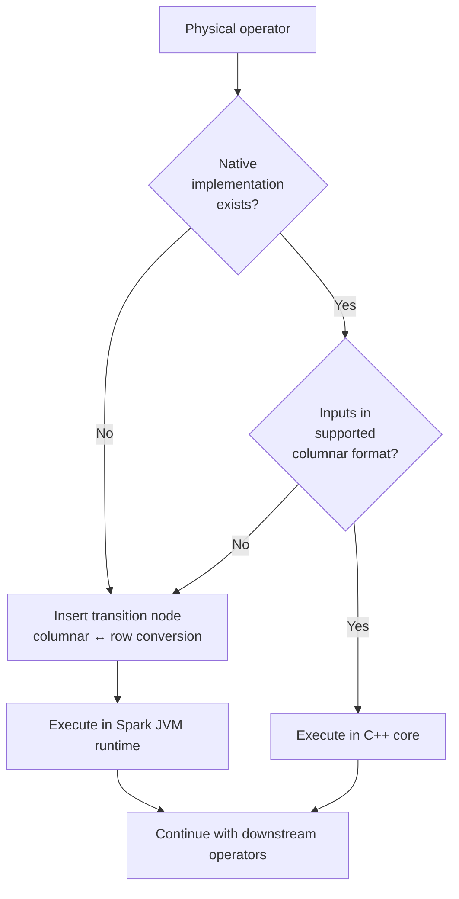
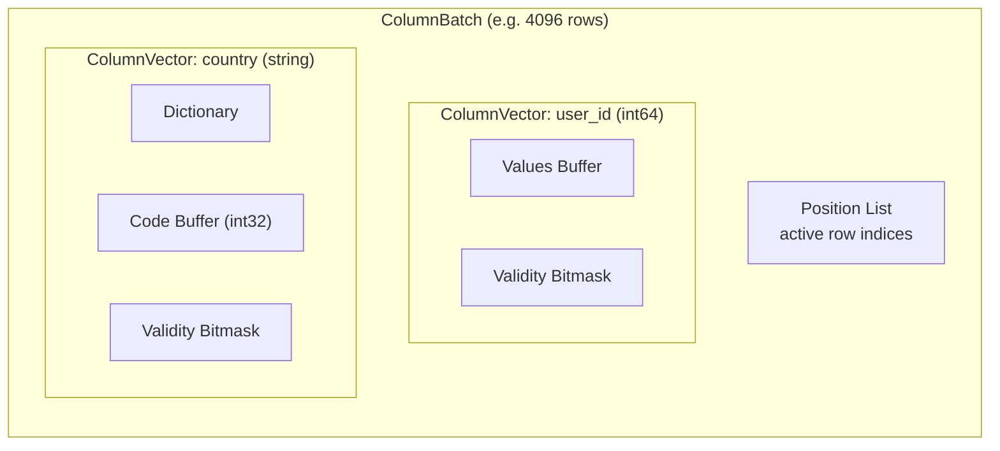
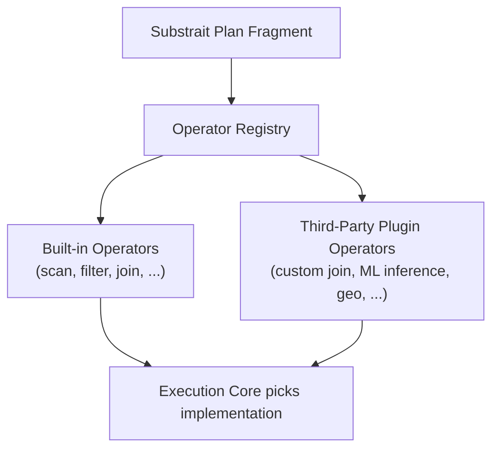

# Quantum Engine — Architecture Documentation

> **Quantum Engine** is an open-core execution engine that replaces Apache Spark's
> JVM-based execution core with a high-performance, vectorized C++ implementation.
> Inspired by proprietary engines like Databricks Photon, Quantum Engine brings
> native, bare-metal acceleration to the open-source big-data ecosystem — without
> vendor lock-in.

---

## Table of Contents

1. [Overview](#1-overview)
2. [Design Goals & Non-Goals](#2-design-goals--non-goals)
3. [System Architecture](#3-system-architecture)
4. [Layer-by-Layer Detail](#4-layer-by-layer-detail)
5. [Component UML](#5-component-uml)
6. [Class Model — Execution Core](#6-class-model--execution-core)
7. [Query Execution Workflow](#7-query-execution-workflow)
8. [Memory Model](#8-memory-model)
9. [Fallback Mechanism](#9-fallback-mechanism)
10. [Data Format — QuantumVector](#10-data-format--quantumvector)
11. [Extensibility & Plugin Model](#11-extensibility--plugin-model)
12. [Comparison with Databricks Photon](#12-comparison-with-databricks-photon)
13. [Glossary](#13-glossary)

---

## 1. Overview

Apache Spark's default execution path runs on the JVM and processes data row-by-row
through whole-stage code generation. This architecture has two structural ceilings:

- **Garbage-collection overhead** — once heap sizes grow large (tens of GB), GC pauses
  become unpredictable and degrade tail latency.
- **No fine-grained hardware control** — the JVM does not expose hand-written SIMD
  kernels, explicit memory pipelining, or cache-conscious data layouts.

Quantum Engine addresses both by moving the *execution layer* (not the planning layer)
into a native C++ runtime that processes data in **columnar batches** using **SIMD**
instructions, while remaining fully compatible with existing Spark SQL and DataFrame code.

The query optimizer (Spark Catalyst) is **reused unchanged**. Quantum Engine intervenes
only after the physical plan is produced, swapping supported operators for their native
equivalents and transparently falling back to the JVM for anything it does not yet support.

### Key Properties

| Property | Description |
|---|---|
| **Drop-in** | No user code changes — same Spark SQL / DataFrame / PySpark API. |
| **Native** | Execution core is C++; no JVM, no GC, no JIT warm-up in the hot path. |
| **Vectorized** | Operators consume batches of thousands of rows; SIMD across columns. |
| **Open-core** | Engine is open source; enterprise plugins are commercial add-ons. |
| **Arrow-native** | In-memory format is Apache Arrow-compatible for ecosystem interop. |
| **Graceful fallback** | Unsupported operators run on the standard Spark runtime, transparently. |

---

## 2. Design Goals & Non-Goals

### Goals

- **G1 — Transparent acceleration.** Existing Spark jobs run faster with no rewrite.
- **G2 — Native UDF support.** Allow C++/Rust UDFs to execute inside the native core
  (a gap Photon does not close).
- **G3 — Full streaming support.** Support both stateless *and* stateful Structured Streaming.
- **G4 — Open extensibility.** Third parties can register native operators via a documented
  plugin API built on the Substrait cross-engine IR.
- **G5 — Hardware portability.** Target x86 (AVX2/AVX-512) and ARM (NEON/SVE); reserve a
  GPU offload hook.

### Non-Goals

- **NG1** — Replacing Catalyst. Planning and optimization stay on the JVM.
- **NG2** — Changing the storage layer. Quantum reads existing Parquet / Iceberg / Delta.
- **NG3** — A new public DataFrame API. Compatibility with Spark's API is mandatory.
- **NG4** — Distributed scheduling. Quantum accelerates *tasks*; Spark still schedules them.

---

## 3. System Architecture

The engine is organized into seven horizontal layers. Planning and the user API remain on
the JVM; the execution core and everything beneath it run in native code.

---

## 4. Layer-by-Layer Detail

### L0 · User API Layer (JVM / Python)

The public surface is **100% Spark-compatible**. Users submit work through Spark SQL,
the DataFrame API, PySpark, or the Structured Streaming API. Nothing in user code
indicates that Quantum Engine is present; acceleration is enabled by a cluster-level
configuration flag (`spark.quantum.enabled = true`).

### L1 · Query Planning Layer (JVM)

Catalyst performs analysis, logical optimization, and physical planning exactly as it
would without Quantum. A dedicated planner extension — **`QuantumPlanner`** — then runs a
post-planning pass over the physical plan:

1. **Eligibility tagging.** Each physical operator is tagged `QUANTUM_ELIGIBLE` or
   `JVM_FALLBACK` based on whether a native implementation exists and the inputs are in a
   supported columnar format.
2. **Plan rewriting.** Minor, semantics-preserving rewrites are permitted (e.g. converting
   a sort-merge join into a hash join when the native hash-join kernel is faster). Join order
   and overall plan structure are preserved.
3. **Boundary insertion.** Where an eligible region meets a fallback region, a
   **transition node** is inserted to convert between columnar (native) and row
   (JVM) representations.

### L2 · JNI Bridge (QuantumBridge)

The bridge is the controlled boundary between managed (JVM) and native (C++) code.

- **Plan handoff.** The eligible plan sub-tree is serialized to a Protobuf message and
  passed across JNI. Only the *plan* crosses — never the data itself in the hot path.
- **Pointer exchange.** Data buffers live in **off-heap memory**. The JVM and native core
  exchange pointers, not copies, achieving zero-copy handoff for the common case.
- **Error propagation.** Native exceptions are translated into structured error codes that
  surface as ordinary Spark exceptions, so Spark's task-retry and fault-tolerance machinery
  continues to function.

> Unlike Photon's internal JNI layer, QuantumBridge has a **documented wire format**, which
> is what makes the third-party plugin model (L6) possible.

### L3 · C++ Native Execution Core

Six cooperating sub-systems:

| Sub-system | Responsibility |
|---|---|
| **Vectorized operators** | Scan, filter, project, aggregate, join, sort — each consumes a batch of column vectors and emits a batch. SIMD is applied across the values of a column. |
| **Memory manager** | Arena-based off-heap allocator; per-query memory budgets; cooperative spill-to-disk coordinated with Spark's memory manager to avoid double-counting. |
| **Adaptive kernels** | Each operator can choose among multiple kernel variants at runtime based on observed data statistics (cardinality, null density, sortedness). |
| **Expression engine** | Evaluates scalar and aggregate expressions with full null-safety, operating directly on dictionary-encoded columns where possible. |
| **Shuffle & exchange** | Native repartition / sort / hash shuffle that avoids JVM serialization for shuffle data. |
| **Native UDF runtime** | Executes UDFs compiled to a native ABI (C++ / Rust), keeping them inside the vectorized pipeline with no JVM round-trip. |

### L4 · QuantumVector (Columnar In-Memory Format)

Quantum adopts an **Apache Arrow-compatible** layout rather than a private format. Each
column vector carries:

- a **values buffer** (contiguous, fixed- or variable-width),
- a **validity bitmask** (one bit per row indicating null/non-null),
- an optional **dictionary** for low-cardinality encoded columns, and
- a shared **position list** identifying which rows in the batch are currently active
  (so a filter removes indices rather than physically compacting data).

### L5 · Storage I/O Layer

Pluggable, predicate-pushdown-aware readers and writers for Parquet, Iceberg, Delta Lake,
and ORC against S3 / ADLS / GCS. A local **NVMe disk cache** transcodes frequently read
data into the QuantumVector layout on first access, dramatically accelerating repeated scans.

### L6 · Observability & Extension Layer

- **Metrics** — Prometheus-format per-operator timings, SIMD utilization, spill counts.
- **Query trace** — structured JSON trace compatible with the Spark UI; no separate tooling.
- **Plugin API** — third parties register native operators using **Substrait** plan fragments.
- **GPU hook** — a reserved interface for offloading select heavy operators to CUDA / ROCm.

---

## 5. Component UML

The component diagram shows ownership and dependency direction across the JVM / native
boundary.

---

## 6. Class Model — Execution Core

A simplified class diagram of the native operator hierarchy. Every operator implements a
common pull-based interface and exchanges `ColumnBatch` objects.

---

## 7. Query Execution Workflow

The end-to-end sequence of a single query, from submission through native execution and
result return, including the fallback branch.

---

## 8. Memory Model

Quantum manages execution memory **off-heap** and coordinates with Spark's unified memory
manager so the two never double-allocate. The diagram shows how a query's memory budget is
partitioned and how spill is triggered.

**Spill policy.** When an operator (e.g. a hash aggregate) cannot grow its hash table within
the granted budget, the memory manager triggers a cooperative spill: the largest spillable
partition is serialized to NVMe in compressed form, freeing memory without aborting the query.
Because the budget is shared with Spark, JVM-side operators in a mixed plan are accounted for
in the same ledger.

---

## 9. Fallback Mechanism

Not every operator has a native implementation. The fallback path keeps correctness while the
operator coverage grows over time.

**Cost of fallback.** Each columnar-to-row (and back) conversion at a transition node has a
real cost. The `QuantumPlanner` therefore minimizes the number of transitions: it prefers to
keep contiguous regions on one side rather than ping-ponging across the boundary. A query that
runs *mostly* in fallback gains little, which is why operator coverage is the primary roadmap
metric.

---

## 10. Data Format — QuantumVector

The on-the-wire and in-memory representation of a single batch.

- **Position list** — a filter removes indices here instead of compacting the values buffer,
  so filters are nearly free until a materialization point.
- **Validity bitmask** — one bit per row; SIMD-friendly null handling.
- **Dictionary encoding** — low-cardinality string columns store small integer codes plus a
  shared dictionary, cutting memory and enabling fast group-by on the codes.

---

## 11. Extensibility & Plugin Model

Quantum's open-core nature is realized through a Substrait-based plugin API. A plugin
contributes a native operator implementation and a mapping from a Substrait relation to that
implementation.

**Registration flow.** At engine startup, plugins register `(SubstraitRelType -> OperatorFactory)`
pairs into the operator registry. During planning, when `QuantumPlanner` emits a Substrait
fragment that matches a registered type, the corresponding native factory builds the operator.
This is the seam that lets the community add operators (e.g. vectorized ML inference, geospatial
predicates) without forking the engine.

---

## 12. Comparison with Databricks Photon

| Dimension | Databricks Photon | Quantum Engine |
|---|---|---|
| **License** | Proprietary, closed-source | Open-core (engine open; enterprise plugins commercial) |
| **Planning** | Reuses Spark Catalyst | Reuses Spark Catalyst |
| **Execution** | Native C++, vectorized | Native C++, vectorized |
| **JVM ↔ native** | Internal JNI bridge | Documented JNI bridge (Protobuf wire format) |
| **In-memory format** | Internal columnar format | Apache Arrow-compatible (QuantumVector) |
| **UDF support** | No native UDFs (falls back) | Native C++ / Rust UDF runtime |
| **Streaming** | Stateless streaming only | Stateless + stateful streaming |
| **Operator extensibility** | None (closed) | Substrait plugin API |
| **GPU offload** | No public hook | Reserved extension hook |
| **Hardware targets** | x86 SIMD | x86 (AVX2/AVX-512) + ARM (NEON/SVE) |
| **Platform** | Databricks Runtime only | Any Spark-compatible cluster |

> Photon validated the core thesis — vectorized native execution beats JVM whole-stage
> codegen for analytical workloads — and reported average speedups around 3× over the
> previous Databricks Runtime, with maxima above 10×. Quantum Engine targets the same class
> of acceleration while closing Photon's openness, UDF, and streaming gaps.

---

## 13. Glossary

| Term | Definition |
|---|---|
| **Catalyst** | Spark's query optimizer; produces the physical plan. Reused unchanged by Quantum. |
| **Vectorized execution** | Processing batches of column values per operator call so the CPU can apply SIMD and amortize per-call overhead. |
| **SIMD** | Single Instruction, Multiple Data — one CPU instruction operating on multiple values at once. |
| **JNI** | Java Native Interface — the bridge for calling native (C++) code from the JVM. |
| **Off-heap memory** | Memory outside the JVM heap, not subject to garbage collection. |
| **Column batch** | A unit of work: a few thousand rows represented as a set of column vectors. |
| **Position list** | Indices of the currently-active rows in a batch; used to apply filters cheaply. |
| **Validity bitmask** | One bit per row indicating whether the value is null. |
| **Dictionary encoding** | Storing low-cardinality values as small integer codes plus a shared dictionary. |
| **Transition node** | A plan node that converts between native columnar and JVM row formats at a fallback boundary. |
| **Substrait** | A cross-engine intermediate representation for query plans; basis of the plugin API. |
| **Fallback** | Routing an unsupported operator to the standard Spark JVM runtime, transparently. |

---

*Document version 0.1 — Quantum Engine architecture draft.*
